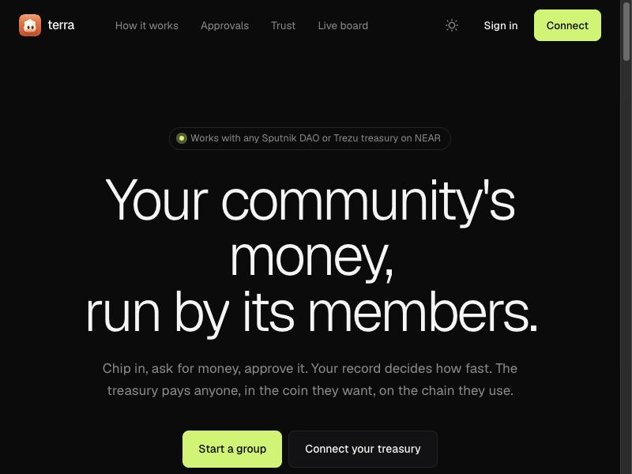
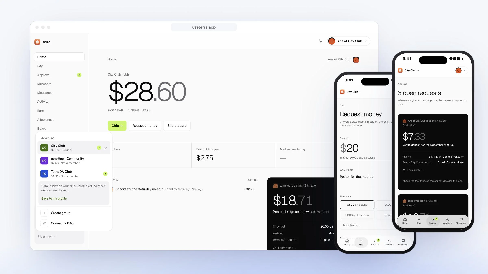
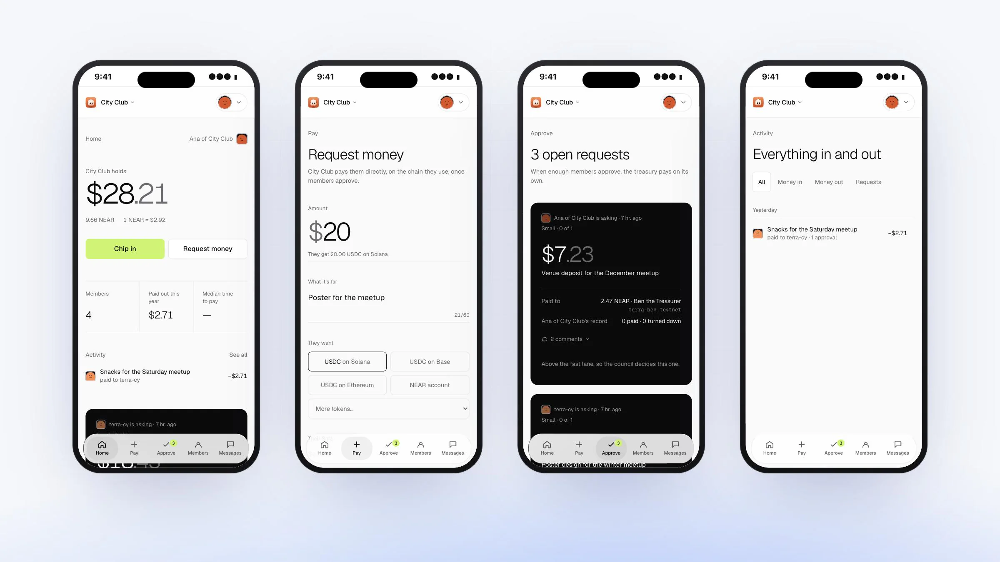
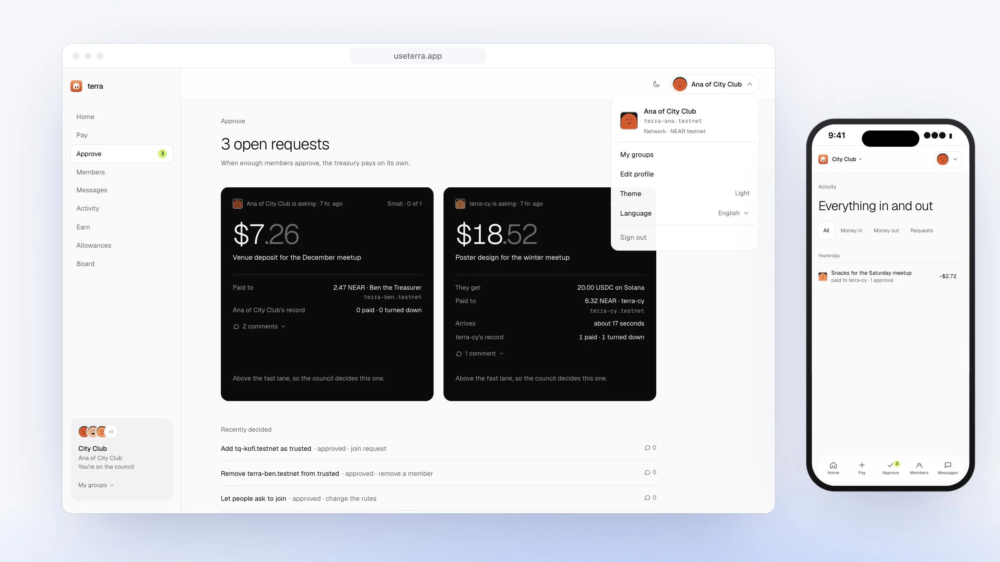
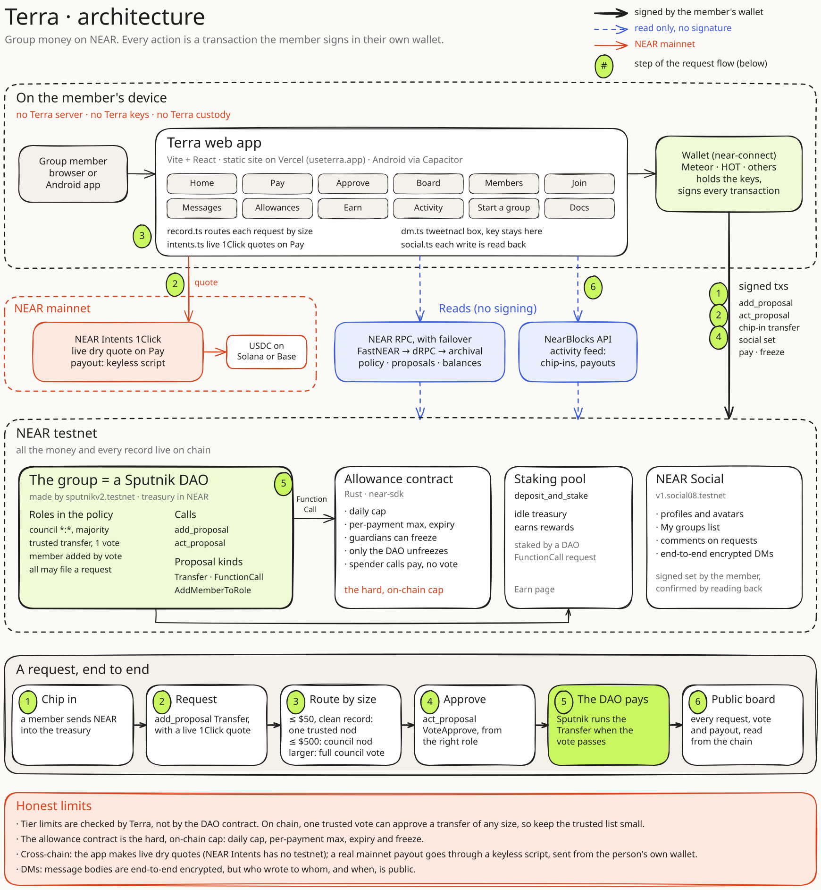

<div align="center">
  
  <h1>Terra</h1>
  <p><b>Your community's money, run by its members.</b></p>
  <p>A members' app for a community treasury, on top of the Sputnik DAO you already have.<br/>Chip in, ask for money, approve it. Your record decides how fast. Every payout is public.</p>
  <p>
    <a href="https://useterra.app"><b>Live app</b></a> ·
    <a href="https://useterra.app/?dao=nearhack-community.sputnikv2.testnet#/home">Demo group</a> ·
    <a href="https://useterra.app/?dao=terra-demo.sputnikv2.testnet#/board">Public board</a> ·
    <a href="https://github.com/somewherelostt/terra/releases/tag/v1.0.0">Android app</a> ·
    <a href="https://github.com/somewherelostt/terra/issues">Report a bug</a>
  </p>
  <p>Built at <b>NEAR HACKATHON</b> · Tracks <code>social</code> · <code>open</code> · <code>security</code> · Runs on NEAR testnet</p>
  
</div>

---

## The why

Groups that share money, like a meetup crew, a club or a hackathon community, usually pick one of two bad options. One person holds the money and everyone trusts them. Or the group uses a multisig built for crypto people: proposals, bonds, gas and raw token amounts.

NEAR already has good treasury dashboards for admins and finance teams. **The members, who chip in, ask for money and decide, had no app of their own.**

Terra is that app. It sits on top of a community's **existing Sputnik DAO** and never holds the money or deploys its own multisig:

- Members see one balance **in dollars**, chip in, request money and approve requests.
- Each member's **record**, computed from the DAO's own history, decides how much approval a request needs. Small requests from trusted members pass on one nod; big ones go to the council.
- A **live NEAR Intents quote** shows what a recipient on another chain would get.
- A **public board** shows every payout, with a receipt on chain.

## See it

The real app, running on City Club (a demo group on NEAR testnet). The images follow your GitHub theme.

<div align="center">
  <picture><source media="(prefers-color-scheme: dark)" srcset="public/shots/terra-hero-dark.webp" /></picture>
  <p><sub><b>One app for the whole group.</b> Switch between your groups, chip in, ask for money with a live quote, and approve.</sub></p>
  <picture><source media="(prefers-color-scheme: dark)" srcset="public/shots/terra-screens-dark.webp" /></picture>
  <p><sub><b>Chip in</b> · <b>Ask</b> · <b>Approve</b> · <b>Paid</b>. Every payout is public.</sub></p>
  <picture><source media="(prefers-color-scheme: dark)" srcset="public/shots/terra-account-dark.webp" /></picture>
  <p><sub><b>Your account, your record.</b> Names come from NEAR Social profiles; the account id always stays visible.</sub></p>
</div>

## What it does

**Core (treasury)**
- **Home:** the balance in US dollars, with NEAR and today's price underneath. A new group gets a "get going" checklist: chip in, invite, first request.
- **Chip in:** send NEAR straight to the DAO account.
- **Request money:** "pay [account or address] [$ amount] for [reason]". The recipient can pick a token on another chain (USDC on Solana is the default, plus a short list of others) and a live NEAR Intents quote is saved in the proposal. A request link opens Pay already filled in.
- **Approve:** request cards with tier, requester record, quote and "N of M" approvals. **Approve and pay** opens a payout tracker driven by chain state. Terra blocks approvals the treasury can't cover, since the vote would revert.
- **Members:** each member's standing (Council, Trusted, New), chip-ins, requests paid and fast-lane limit, plus people with a record who aren't members yet.
- **Activity:** every chip-in, request, vote and payout, linked to NearBlocks.
- **Earn:** propose staking idle money with a testnet validator; members approve it like any request.
- **Board:** the public, read-only page described above.
- **Start a group:** three steps (group, people, review and sign). It keeps council and trusted apart, adds an empty `member` role, needs at least 6 NEAR (about 5.4 NEAR stays locked to store the contract), checks your balance, and confirms the DAO really exists after the factory call. Group names can use any characters (curly quotes, accents, emoji, Hindi). The factory refunds the deposit instead of failing when creation doesn't work.

**Social layer (NEAR Social, testnet `v1.social08.testnet`)**
- **Member profiles:** a display name, avatar, short bio and links (X, GitHub, website, Telegram), set in **Edit profile** from the account chip or your own row in Members. They're saved to the member's standard NEAR Social profile (`profile/name`, `profile/description`, `profile/linktree/*`, plus `terra/avatar`), signed by the member. So a profile set in Terra shows in other NEAR apps, and a name set elsewhere shows in Terra. Only changed fields are written. A storage deposit is attached only when the member's SocialDB storage is short (0.05 NEAR on a first write). Names appear everywhere a member does, with the account id kept visible, small and muted. Reads are one batched SocialDB `get` per group, cached.
- **Comments on requests:** a thread on each Approve card, and a comment count on the Board and under "Recently decided" that opens the request with its thread. Only group members and the request's proposer are shown; comments from anyone else are folded under "Show N comments from non-members". Comments are stored at `<author>/terra/comments/<daoId>/<proposalId>/<ms>`, plus the standard `post/comment` and `index/comment`. They're read with one wildcard SocialDB `get`, with no backend or indexer. Plain text, 280 characters max.
- **Private messages (DMs):** 1-to-1 messages between members of a group, end-to-end encrypted in the browser with tweetnacl `box` (X25519 + XSalsa20-Poly1305). Each member's secret key is made in their browser and never leaves it; the public key is published at `<id>/terra/dmkey`. Messages are stored as ciphertext and nonce at `<sender>/terra/dm/<recipient>/<id>`. See the privacy limits under [What's real vs. testnet](#whats-real-vs-testnet).
- **My groups:** a switcher in the sidebar and the phone top bar. Each row shows the group name, balance in dollars, your role and open requests, and switches in one click. It also has "+ Create group" and "Connect a DAO". The list comes from your NEAR Social profile (`<id>/terra/groups`), membership found in each known group's policy, and groups you visited. Signed out, it shows visited groups only.

**Joining**
- **Join by QR:** Members → **Invite** shows a QR code and a join link. Opening it shows the group, its balance and members. **Sign in to ask** files an `AddMemberToRole` request, and a "Waiting for approval" card updates by itself until the council decides in Approve. Groups made with Start a group take join requests from the start. For other DAOs, a council member taps **Let people ask to join** in the Invite sheet first: one council vote adds a plain `member` role and lets anyone file a join request.
- Anyone with a NEAR testnet wallet can chip in and file a request without joining. After one paid request with none turned down, that person's small requests take the fast lane.

**Allowances (security track)**
- The group gives a member or an AI helper a small budget: a daily cap, a most-per-payment and an end date. Payments inside it skip the vote, and any council member (a guardian) can freeze it instantly.
- It's a small Rust contract the DAO owns (`contracts/allowance`, near-sdk 5.6, 13 unit tests; design in `contracts/allowance/README.md`). Creating or changing an allowance, or unfreezing, is a normal DAO `FunctionCall` request. The spender calls `pay` directly.
- An AI helper gets a NEAR **function-call access key** limited to that contract's `pay` method, with a 0.25 NEAR gas allowance. It can't transfer NEAR, call anything else or go over its budget. On testnet the node refused `transfer`, `freeze`, `set_allowance` and deposit attempts made with that key, and the contract refused payments over the per-payment max and over the daily cap.
- **Enforced on chain:** the daily cap, the per-payment max, expiry and freeze. Only the DAO can change limits or unfreeze, and only guardians or the DAO can freeze.
- **Not on chain:** dollar amounts. Caps are stored in NEAR, converted from dollars at the price when the request is filed. Which contract belongs to which group is a map in the app (`src/lib/allowance.ts`). Budgets share one pool, and a "day" is a UTC calendar day.
- Allowances are set up on City Club (`allowance.terra-ben.testnet`, no budgets yet). nearHack Community has no allowance contract, so its Allowances page says "Not set up for this group yet".

**Design**
- Web first, with a phone layout: a floating frosted tab bar, a frosted top bar, and bottom sheets that rise over a blurred page, with a solid fallback where blur isn't supported. The landing page has a navbar that turns frosted on scroll. Dark and light themes.

## How it meets the Social Money prompt

| The prompt asks for | What Terra does | Where in the code |
|---|---|---|
| Use the community's existing DAO or Trezu treasury for custody and approvals; don't build a new multisig | Type any Sputnik DAO account and Terra reads and writes to it. Money only moves through that DAO's own `add_proposal` and `act_proposal`. "Start a group" is for communities with no DAO yet, and it calls the standard testnet factory `sputnikv2.testnet`. | `src/lib/dao.ts`, `src/pages/Landing.tsx`, `src/pages/CreateGroup.tsx` |
| Reputation tied to named accounts, traceable | Each named account's record (requests, paid, turned down, chipped in, votes) is computed only from the DAO's whole proposal history and its NearBlocks transactions. Every row links to its proposal or transaction. Members can add a NEAR Social profile, but the account id always stays visible. | `src/lib/record.ts`, `src/pages/Members.tsx` |
| Small payouts auto-approve for trusted contributors | **Fast lane** (up to $50, requester has a clean record or a `council`/`trusted` role): one approval from a member of the `trusted` role **other than the requester** executes the payout. In the Terra policy the `trusted` role has a 1-vote threshold for transfers. A first request from someone with no record goes to the council instead. | `routeRequest` in `src/lib/record.ts`, `newGroupPolicy` in `src/lib/dao.ts` |
| Mid-size payouts need one council member | **Council nod** ($50 to $500): routed to the `council` role at the council's own threshold. That's one council member only when the DAO's council threshold is one vote. Terra's default policy uses a council majority, so a 2-member council means both members. Sputnik approves as soon as any one role reaches its threshold, so Create group keeps council members out of the `trusted` role. Otherwise one council member's vote would also count as a trusted nod and pay out any amount. | `src/lib/record.ts`, `src/pages/CreateGroup.tsx` |
| Large payouts become a normal DAO proposal | **Full vote** (over $500): the council votes at its normal threshold, and the request stays on the public board while it's open. | `src/lib/record.ts`, `src/pages/Board.tsx` |
| A public board | `?dao=<dao>#/board`: no sign-in and no buttons that move money. Shows the balance, paid-out total, members, median time to pay, staking, open requests, and each payout with who approved it, a proof link and its comment thread. | `src/pages/Board.tsx` |

The dollar limits of each tier are enforced by the app, not by the contract. See [What's real vs. testnet](#whats-real-vs-testnet).

## How NEAR is used

- **Sputnik DAO (v2/v3) on testnet.** Reads: `get_config`, `get_policy`, `get_proposals`, `get_proposal`, `get_last_proposal_id`. Writes:
  - `add_proposal` with these kinds: `Transfer` for payment requests, `FunctionCall` for staking and allowances, `AddMemberToRole` for joins and invites, and `ChangePolicy` for "Let people ask to join". Each attaches the exact `proposal_bond` from the DAO's policy.
  - `act_proposal` with `VoteApprove` or `VoteReject`, passing the proposal `kind` back as v3 contracts require. When the threshold is met, the DAO pays out on its own.
  - New groups: the factory `sputnikv2.testnet` method `create`, with a Terra-shaped policy:
    - `council`: can do everything; transfers need a council majority.
    - `trusted`: one vote approves a transfer; never the same accounts as the council.
    - `member`: people who joined; starts empty.
    - `all`: anyone can file a payment request or ask to join.
- **NEAR Intents 1Click API** (`https://1click.chaindefuser.com/v0`). `GET /tokens` loads the token list and the NEAR/USD price behind every dollar amount. `POST /quote` runs with `dry: true` and `swapType: EXACT_OUTPUT` ("the recipient gets exactly X; how much NEAR does the treasury send?"). No API key is used.
- **Staking.** Earn files a DAO `FunctionCall` proposal calling `deposit_and_stake` on a testnet validator pool (default `aurora.pool.f863973.m0`). The stake is read with `get_account_total_balance`.
- **NEAR Social (SocialDB `v1.social08.testnet`).** Profiles, avatars, comments, DM keys and messages, and the My groups list are all written with `set`, signed by the member's own wallet, and read with `get`. Explorers can label SocialDB writes "failed" even when the data lands, so Terra confirms each save by reading it back.
- **Access keys.** Allowance helpers get a function-call key limited to one method on one contract, with a gas allowance (`AddKey`).
- **Named accounts.** Every screen shows readable `name.testnet` accounts. Records, tiers, approvals and profiles all key on the account name.
- **Wallets and reads.** NEAR Connect (`@hot-labs/near-connect`) handles sign-in and signing on testnet. Reads go over JSON-RPC: FastNEAR first, then dRPC (`near-testnet.drpc.org`), then FastNEAR's archival RPC. The app fails over and backs off on rate limits, caps parallel requests, and caches activity for a minute. The activity feed uses the NearBlocks testnet API.

## Architecture

<p align="center">
  <a href="docs/architecture.svg"></a>
</p>

Terra is a static web app with no server of its own. The member's wallet (through near-connect) signs every write, and Terra never holds keys or money. Each group is a Sputnik DAO on NEAR testnet. Profiles, comments, encrypted DMs and the My groups list live on NEAR Social. The allowance contract and the staking pool are reached through DAO `FunctionCall` requests. Reads go to NEAR RPC (FastNEAR, then dRPC, then archival) and NearBlocks, and quotes come live from NEAR Intents 1Click on mainnet. The green numbers match the six steps of a request along the bottom, and the red box repeats the honest limits. The source is [`docs/architecture.excalidraw`](docs/architecture.excalidraw); open it at [excalidraw.com](https://excalidraw.com) to edit.

## Try it

You need a browser. Steps 1–7 need no account. Steps 8–12 need **two NEAR testnet accounts**: any NEAR wallet on testnet, funded from the testnet faucet. Intear works on phones and Meteor on desktop; see [Android app](#android-app).

**Look around (no account)**

1. Open https://useterra.app → the landing page explains Terra, with a live quote card. At the bottom, click **look around nearHack Community** → Home opens for `nearhack-community.sputnikv2.testnet`, a real group made with Start a group.
2. On **Home** → the treasury balance is shown in **US dollars** (about $8, 2.59 NEAR), with today's NEAR price underneath. The group is new, so Home shows the "Get nearHack Community going" checklist instead of activity.
3. Click **Pay**. Type `20` in Amount and any reason, keep **USDC on Solana**, and paste any Solana address in **Their Solana address** → within a few seconds a card labelled **Live quote · NEAR Intents** shows "They get exactly 20.00 USDC", how much NEAR the treasury sends (about 6.5 NEAR at today's price), the fees, and the arrival time (about 20 seconds). It refreshes on a timer. The note under it says which approval lane the request would take.
4. Click **Members** → 4 members, 2 Council and 2 Trusted (no account is in both). Click **Invite** → a QR code and the join link. Open the link → the "You're invited to nearHack Community" page, with **Sign in to ask**.
5. Click **Board** (or open https://useterra.app/?dao=nearhack-community.sputnikv2.testnet#/board in a private window) → the public board, with no sign-in and no money buttons. It's in its empty state for now ("No payouts yet").
6. Now open the seeded test group, **City Club**: https://useterra.app/?dao=terra-demo.sputnikv2.testnet#/approve → three open requests:
   - a $20 poster design paid in USDC on Solana, with its Intents quote saved in the proposal;
   - an $8 venue deposit;
   - an invite to add a member to the council.

   Each card shows who asked (by profile name, with the account id), its tier and approvals ("Small · 0 of 1"), the requester's record and a comment count. Under **Recently decided**: a paid snacks request, a declined printer-ink request, and the role changes described in [What's real vs. testnet](#whats-real-vs-testnet).
7. Open City Club's **Board** → the open requests, and the $3 snacks payout marked "1 trusted member" (that was the fast lane), each with a comment count that opens the thread.

**Signed flows (two testnet accounts, A and B)**

8. On the landing page click **Start a group**. Signed in as A: name the group, list A as council and B as trusted (an account on the council can't also be trusted, and the form explains why), set a starting deposit of at least 6 NEAR, review, and sign the one factory call → Home opens on your new DAO and it appears in **My groups**.
9. As A: **Home → Chip in** 1 NEAR → the balance goes up and the chip-in appears in Activity. Click your account chip → **Edit profile** → set a name → it shows next to your account id across the app.
10. As B: open your group's join link (Members → Invite as A, or `#/join`), then **Sign in to ask** → "Waiting for approval". As A in **Approve**, approve it → B's card turns into "You're in".
11. As A: **Pay**, choose **NEAR account**, pay B $1 → sign → the request appears in **Approve** as Small. A is on the council, which counts as a clean record, so it takes the fast lane. Sign in as B (trusted) → **Approve and pay** → the payout tracker follows it to "Paid", and it shows in Activity, on the Board and in A's record. A request from someone who just joined, with no record yet, goes to the council instead.
12. On any request in Approve, add a comment → it shows on the card and on the Board. In **Messages**, set up your key and send B a private message → B sees it after setting up their own key.

These signed flows have been run end to end on testnet: in City Club (chip in, a request with a live quote, fast-lane approval and payout, a decline, an invite, a council vote, avatar and profile saves, comments, DMs, join requests) and in three groups made from empty with Start a group (`nearhack-community`, `tq-garden-club`, `tq-tool-library`): create, join, chip in, a first request decided by the council, then fast-lane payouts. Create group was also verified on `terra-qa-club.sputnikv2.testnet` ([tx](https://testnet.nearblocks.io/txns/XNBfkstsCqvZzXXkAdSnf7HEqPnMWJawbh2JiEE2H5J)). nearHack Community's creation: [tx](https://testnet.nearblocks.io/txns/9gqdtL16KSqXAVHu6p61ZkkUHWBWZL86j419bRzLGeD9).

**Allowances (City Club council)**

13. As a City Club council member: **Allowances → Propose an allowance** (who, $ per day, $ per payment, days) → the council approves it in Approve → as that member, Pay shows the allowance → pay inside it with no vote → try more than the per-payment max → refused → a council member taps **Freeze** → the next payment is refused.

## Android app

Terra also ships as an Android app on testnet: [terra-1.0.0.apk](https://github.com/somewherelostt/terra/releases/download/v1.0.0/terra-1.0.0.apk) (4.1 MB, Android 7.0+), from the [v1.0.0 release](https://github.com/somewherelostt/terra/releases/tag/v1.0.0). It's a Capacitor 8 wrapper of the same web app, in `android/`.

1. Open the release page on your phone and tap `terra-1.0.0.apk`.
2. Allow your browser to install unknown apps (Settings → Apps → your browser → Install unknown apps).
3. Open the file and tap **Install**. If Play Protect warns about an unknown developer, choose **More details → Install anyway**.
4. Open Terra → **look around nearHack Community**.

SHA-256: `b0945283226cfa1e3483b37790853d570a4addd0dabd9ad867626b8c3aff9a37`

- **Wallets:** wallets that sign in through a web popup work inside the app; the popup opens in an in-app window. Intear Wallet uses this flow and needs Android System WebView 137 or newer (current on any phone with Play updates). Meteor Wallet's mobile flow fails on Android testnet, in Chrome as well as in the app. On a phone, use Intear, or use the web app on desktop with Meteor.
- **Invite links** open the app: `terra://open?dao=<dao>#/join`, and `https://www.useterra.app/?dao=…` links once Android has verified the domain through `/.well-known/assetlinks.json`.
- **Build it yourself:** `scripts/android/build-apk.sh` (needs JDK 21 and the Android SDK).

## Getting started

Requires Node 20.19+ or 22.12+ (what Vite 8 needs) and pnpm (the repo pins `pnpm@12.14.0` in `packageManager`).

```bash
pnpm install
cp .env.example .env   # optional; the defaults below are used without it
pnpm dev               # http://localhost:5173
```

`.env.example`:

| Variable | Default | What it does |
|---|---|---|
| `VITE_DEMO_DAO` | `nearhack-community.sputnikv2.testnet` | Group opened by "look around nearHack Community" |
| `VITE_STAKING_POOL` | `aurora.pool.f863973.m0` | Testnet validator pool used by Earn |

Optional: `VITE_ALLOWANCE_CONTRACTS="dao=contract,dao2=contract2"` maps more groups to their allowance contracts.

Other scripts: `pnpm build` (type-check and production build into `dist/`), `pnpm preview`, `pnpm lint`. No backend and no API keys are needed: the app calls NEAR RPC, NearBlocks, SocialDB and the 1Click API straight from the browser. The allowance contract builds and tests with Cargo in `contracts/allowance`.

## Project structure

```text
terra/
├── src/
│   ├── pages/              # Landing, Home, Pay, Approve, Members, Activity, Earn,
│   │                       # Allowances, Messages, Board, Join, CreateGroup, SignIn
│   ├── components/         # Account menu, group switcher, profile, comments,
│   │                       # invite sheet with QR, avatar picker, UI kit
│   └── lib/
│       ├── dao.ts          # Sputnik reads, proposals, votes, Terra policy
│       ├── record.ts       # member records, tiers and request routing
│       ├── intents.ts      # 1Click token list and dry quotes, saved-quote fallback
│       ├── social.ts       # SocialDB reads and writes with read-back
│       ├── profile.ts      # NEAR Social profiles
│       ├── comments.ts     # comment threads on requests
│       ├── dm.ts           # end-to-end encrypted messages
│       ├── groups.ts       # My groups
│       ├── join.ts         # join requests and "Let people ask to join"
│       ├── allowance.ts    # allowance contract calls and helper keys
│       └── near.ts         # JSON-RPC with failover
├── contracts/allowance/    # Rust allowance contract (near-sdk) and its design notes
├── android/                # Capacitor Android project
├── scripts/
│   ├── android/            # build-apk.sh
│   └── intents-payout/     # keyless script for one real mainnet Intents payout
├── docs/                   # architecture diagram (Excalidraw source, SVG, PNG)
│   └── screenshots/        # images in this README
├── public/                 # icons and web manifest
└── vercel.json             # Vercel build settings
```

## What's real vs. testnet

Terra runs on **NEAR testnet**. Every row below is a real transaction you can open on NearBlocks.

| Feature | Where it runs | Proof link |
|---|---|---|
| Create a group (Sputnik factory `create`) | NEAR testnet | [City Club](https://testnet.nearblocks.io/txns/Hy3hR85myJ9UoJ7rHDm9zxkpxTGe9MFP2bpFELSSvDo6) · [nearHack Community](https://testnet.nearblocks.io/txns/9gqdtL16KSqXAVHu6p61ZkkUHWBWZL86j419bRzLGeD9) |
| Group name with curly quotes, accents and emoji | NEAR testnet | [tx](https://testnet.nearblocks.io/txns/G95bZT12fN9sYhPnoc1rKgr8dD2JbYpPM6GHN11i1NoA) |
| Chip in (2 NEAR to the DAO) | NEAR testnet | [tx](https://testnet.nearblocks.io/txns/69RC9NxfXLr62Pdr42bowR9P8VtfimSJd6Z1nNPWoB4y) |
| Request money with a live NEAR Intents quote saved in the proposal | NEAR testnet (quote from the NEAR Intents 1Click API) | [tx](https://testnet.nearblocks.io/txns/6GNyQ3rzFFFkXWquSxdFNXpWUB8JPGqkZTb4HVVuyCJt) |
| Fast lane: one trusted approval pays out | NEAR testnet | [tx](https://testnet.nearblocks.io/txns/9wyJ8fiLk2AHfAomycQGdwz6w7Za3ijQgihRZDRmHGGL) |
| Decline a request | NEAR testnet | [tx](https://testnet.nearblocks.io/txns/fRZQgDpxxttVbczcmLFA9G6VA4JrYvEyT4RRByitauL) |
| Council vote passes a rule change (2 of 2) | NEAR testnet | [tx](https://testnet.nearblocks.io/txns/EeyJXZ6zuQ2bSyqWTuzQqr6Fdbf2gSR9HiQjohFFoTfj) |
| One council approval alone doesn't pay (stays "1 of 2") | NEAR testnet | [tx](https://testnet.nearblocks.io/txns/212Z1Aidh4PhRUWtQiyDKX3ZrcATx2htiWFqrK3hmEmt) |
| Ask to join, then the council approves | NEAR testnet | [ask](https://testnet.nearblocks.io/txns/3QFJZ91QJr9Gps92EnXj7L56Cz5C7wtG8cRHswtZ3u6v) · [approve](https://testnet.nearblocks.io/txns/HEtHLgKGjanpdiyhBWNWuVGQ3AUHut9A5a99BQkJux63) |
| Profile and avatar saved to NEAR Social | NEAR testnet (SocialDB) | [tx](https://testnet.nearblocks.io/txns/HyAutgFa9n3y6fFjUUMo9u7ijNt699xovMoy6GEN8rHQ) |
| Comment on a request | NEAR testnet (SocialDB) | [tx](https://testnet.nearblocks.io/txns/FkYtqB1poNSpeMCKexaXSTjfE9sv9giaQtdfjH1KPMHT) |
| Encrypted private message (ciphertext only on chain) | NEAR testnet (SocialDB) | [tx](https://testnet.nearblocks.io/txns/93ptWqwDe2jrSgcDynrjN5sH1TQskEz3FL8XUecCDvTA) |
| My groups saved to the member's profile | NEAR testnet (SocialDB) | [tx](https://testnet.nearblocks.io/txns/BtpY58wVkoWALaifYApqEhssX1CQDeJHvajSMdMYhwY2) |
| Allowance: payment inside the budget, no vote | NEAR testnet (allowance contract) | [tx](https://testnet.nearblocks.io/txns/Eeujj7H5v8iHCJzmNb7nyMGpwVFuNJVPs6ocnYGzC4Hf) |
| Allowance: payment over the per-payment max is refused | NEAR testnet (allowance contract) | [tx](https://testnet.nearblocks.io/txns/4brjmRuvDvfgD9HCNgMLAFZ9H6A25qnpm6E4yTHym8o1) |
| Allowance: a guardian freezes it instantly | NEAR testnet (allowance contract) | [tx](https://testnet.nearblocks.io/txns/HALjykqpfVmH6a4syhCwHX59uKJSNk4JZULsTbytaykB) |
| AI helper key (can only call `pay`) is refused over its limit | NEAR testnet (allowance contract) | [tx](https://testnet.nearblocks.io/txns/5SsWRfJTcQRojeP5eif784ztDPEvruj42epnjpLLFLV7) |
| Cross-chain payout via NEAR Intents | NEAR mainnet | Mainnet quote only (live); payout pending |

**How the pieces fit, and the limits:**

- **Cross-chain.** Quotes are live from the NEAR Intents 1Click API (mainnet) and run with `dry: true`. NEAR Intents has no testnet, so in the app the treasury pays the quoted amount in NEAR to a NEAR testnet account named on the Pay screen. On mainnet the same request pays the Intents deposit address and the recipient gets the token on their chain. `scripts/intents-payout/` makes one real mainnet payout without an API key; the person sends from their own wallet and the script never signs. If the quote API is down, Pay shows a clearly labelled **Sample quote** recorded on 14 Nov 2026 at 13:00 UTC.
- **Tier limits are checked by Terra, not by the contract.** On chain, one trusted vote can approve a transfer of any size, so keep the trusted list small; allowances (the allowance contract) are the hard, on-chain cap. Sputnik decides approvals by role and proposal kind, not by amount. Terra routes each request to the right role and only offers the vote to the right accounts, but a member of the `trusted` role could still approve a large transfer from another client. A guard contract that checks amounts is the fix (see What's next).
- **The City Club role fix.** City Club (`terra-demo`) was created before Create group kept the roles apart, so one account was on both its council and its trusted role. A council vote removed that overlap: proposal #6 took the account out of `trusted` (filed in [this tx](https://testnet.nearblocks.io/txns/ExS1ZgYUPkCsuuYZrtbcg2bq9JhRQX3LVEBXwbtwypZ8)) and proposal #7 added a separate trusted member (filed in [this tx](https://testnet.nearblocks.io/txns/CcRzrxnFYdG7jFmkCdTYfdM1znWV2R64Qgn853xBY7iE)). The council approved both, and since then a council approval alone leaves a request open (see the table). Terra also warns a council member who is in both roles that their vote alone would pay out.
- **Private messages.** Contents are end-to-end encrypted and the secret key stays in the browser. But who messages whom, and when, is public; the ciphertext stays on chain for good; there's no forward secrecy; a new device or browser needs setup again (messages sent to the old key only open on the old device); clearing site data loses the key. Every message is one wallet-signed write (the first adds a small storage deposit), up to 500 characters of plain text, and the thread checks for new messages every 10 seconds.
- **Allowances.** The daily cap, per-payment max, expiry and freeze are enforced on chain. Dollar amounts and the group-to-contract map are not (see What it does).
- **Staking rewards** arrive once per epoch (about 12 hours on testnet), so a fresh stake shows close to zero rewards at first. Unstaking isn't in the UI.
- **Dollar amounts** use the NEAR/USD price from the 1Click token list. Payouts on testnet are in NEAR.

## Tech stack

No starter template; the project was scaffolded with plain Vite. All code in this repository was written during the hackathon window. AI coding assistants were used while building, as the rules allow (Q-005). Everything used is listed here.

### Web app (`src/`)

- **Framework:** [React 19](https://react.dev/) + [TypeScript](https://www.typescriptlang.org/) + [Vite 8](https://vitejs.dev/) (`@vitejs/plugin-react`)
- **Styling:** [Tailwind CSS 4](https://tailwindcss.com/) (`@tailwindcss/vite`), Geist and Geist Mono from Google Fonts
- **Wallets:** [`@hot-labs/near-connect`](https://github.com/azbang/near-connect) 0.12.0 for sign-in and signing
- **Private messages:** [`tweetnacl`](https://github.com/dchest/tweetnacl-js) 1.0.3 (`box`, end-to-end encryption)
- **Invite QR codes:** [`qrcode`](https://github.com/soldair/node-qrcode) 1.5.4
- **Default avatars:** DiceBear HTTP API (`thumbs` style)
- **Linting:** oxlint

### Android app (`android/`)

- **Wrapper:** [Capacitor](https://capacitorjs.com/) 8.6.0 (`@capacitor/core`, `@capacitor/android`, `@capacitor/cli`)

### Allowance contract (`contracts/allowance/`)

- **Language:** Rust with [`near-sdk`](https://github.com/near/near-sdk-rs) 5.6, 13 unit tests

### NEAR and services

- **Treasury:** [Sputnik DAO](https://github.com/near-daos/sputnik-dao-contract) contract and the testnet factory `sputnikv2.testnet`
- **Cross-chain quotes:** [NEAR Intents 1Click API](https://docs.near-intents.org/) (token list, NEAR price, dry quotes)
- **Social data:** NEAR Social / SocialDB `v1.social08.testnet` (profiles, avatars, comments, private messages, My groups)
- **Chain reads:** NEAR JSON-RPC (FastNEAR, dRPC)
- **Activity feed:** NearBlocks testnet API
- **Hosting:** Vercel (production deploy of `main`)

## Hackathon context

- **Event:** NEAR HACKATHON, November 2026.
- **Tracks:** **`social`** (Social Money), **`open`** (Open Innovation) and **`security`** (AI Security & Defense, for allowances with on-chain limits and scoped keys for AI helpers).
- **Prompt:** Social Money asks for shared budgets, programmable rewards, collective ownership and reputation-based access on top of Sputnik DAO and Trezu, without rebuilding the multisig. Terra is the members' side of that treasury.

## What's next

- One real mainnet payout through NEAR Intents (`dry: false`), then real cross-chain payouts in the app.
- A guard contract that holds the `trusted` role and checks amounts, so tier limits are enforced on chain.
- A function-call key for NEAR Social writes, so comments and messages don't need a wallet signature each time.
- A hand-off to a full treasury dashboard such as Trezu for groups that outgrow the members' app.

## Team

- Built by [@Maaztwts](https://x.com/Maaztwts).

## License

MIT. See [LICENSE](LICENSE).

---

<div align="center">
  Made for communities that share money · <a href="https://useterra.app">useterra.app</a>
</div>
